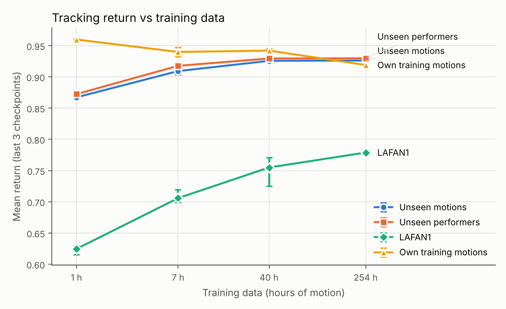
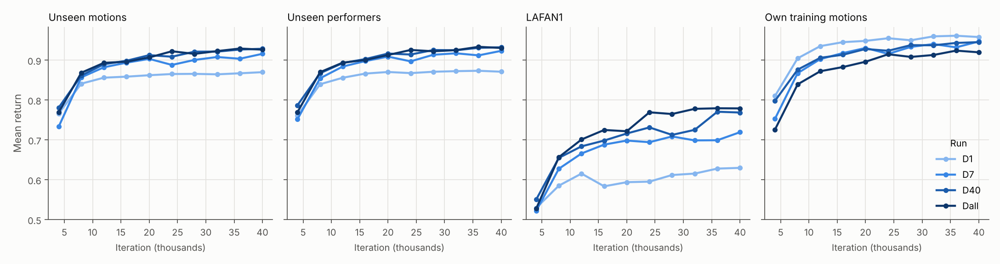
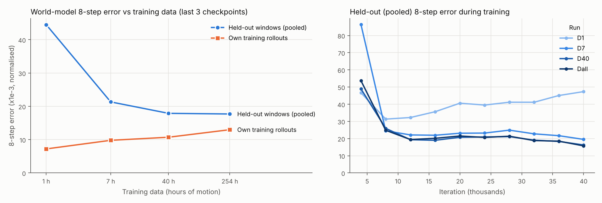
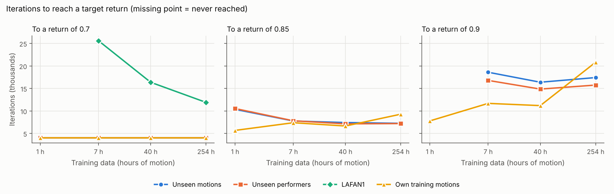

# Held-out data scaling of SuperMimic

Does more motion data make [SuperMimic](https://arxiv.org/abs/2610.28480) better on motions it has never seen?
The paper's data sweep evaluates on training motions only. I trained it on 1, 7, 40 and 254 hours of BONES-SEED and
tested it on three held-out sets.

*Unseen BONES-SEED motions and performers flatten after 40 h. LAFAN1 keeps rising.*

| Training data | Unseen motions | Unseen performers | LAFAN1 |
|---|---:|---:|---:|
| 1 h | 0.867 | 0.872 | 0.624 |
| 7 h | 0.909 | 0.918 | 0.706 |
| 40 h | **0.926** | 0.929 | 0.755 |
| 254 h | **0.926** | 0.930 | **0.779** |

Mean return (1.0 = perfect tracking), averaged over the last 3 checkpoints. Full numbers:
[`results/results.md`](results/results.md).

Built on [LaoYang1994/SuperMimic-Rep](https://github.com/LaoYang1994/SuperMimic-Rep), a fork of
[CuboiLeo/SuperMimic-Reproduced](https://github.com/CuboiLeo/SuperMimic-Reproduced) (MIT).

## Findings

### 1. Within BONES-SEED, 40 hours is enough. Beyond it, extra data only helps on motions from elsewhere.

In the figure above, the two BONES-SEED held-out sets stop improving at 40 h. LAFAN1, recorded in a different studio,
keeps improving up to 254 h, though with one seed the last step could be noise.

### 2. Small data memorizes.

The 1 h run scores highest of all on its own training motions and lowest on everything new. Its curves flatten early,
and more training does not close the gap.

### 3. The world model memorizes even more than the policy.

With 1 h of data, the world model predicts its own training data well but new motions badly (left). As training
continues, it gets *worse* on new motions (right), while its policy holds steady.

### 4. Measured on training motions, small data looks cheap. On new motions, it is the most expensive.

The paper measures compute to a target return on training motions, where the 1 h run gets there first. On unseen
motions it gets there last, and never reaches 0.9.

## How this was built

20 hours from idea to results, using 27 H100-hours (about $120).

| Phase | When (Pacific time) |
|---|---|
| Idea and literature check | Wed 08:30 – 09:30 |
| Experiment design and plan | Wed 09:30 – 10:30 |
| Code and tests | Wed 10:30 – 11:40 |
| Accounts, GPUs, data pipeline | Wed 11:40 – 15:00 |
| Smoke test and launch | Wed 15:00 – 16:00 |
| Training: 4 runs on 2 H100s | Wed 16:00 – Thu 03:00 |
| Evaluation and analysis | Thu 04:00 – 04:45 |

Problems caught along the way

Checking real output against expectations caught:

- **Mirrored motions leaking into training.** BONES-SEED stores each mirrored clip under its own motion name. Found by
  inspecting the metadata before splitting.
- **A command-line flag** that silently dropped two of the three held-out sets.
- **A wrong metadata path** in the download step.
- **An interrupted run** (40 h), resumed from its checkpoint.

Commit timestamps and the run logs record the times above.

## Setup

- **Method:** SuperMimic with the paper's networks and hyperparameters, via SuperMimic-Rep. One H100 per run.
- **Training:** 40,000 iterations per run on the paper's 320,000-iteration schedule. Checkpoints every 4,000.
- **Data:** nested subsets of BONES-SEED of 1, 7, 40 and 254 h. Each subset contains the smaller ones.
- **Evaluation:** three held-out sets, cut into 10-second segments, each played once from its first frame.

Definitions and how the held-out sets were built

**Definitions**

- **Return:** reward summed over a segment, divided by the largest value it can take. 1.0 is perfect tracking.
- **Failure:** the robot falls (pelvis height or tilt beyond the training limits), which ends the segment.
- **Iteration:** one gradient update, about 2.5 simulator steps across 4,096 parallel environments.
- **254 h:** the paper's filters leave 263 h (129,511 clips, within 3 clips of the paper); 8.7 h of that is held out.

**Held-out sets** ([`make_splits.py`](make_splits.py)), carved out before any training subset:

- **Unseen performers:** every clip of randomly chosen performers (2,293 clips, 4.3 h).
- **Unseen motions:** every clip of randomly chosen motions, by any performer (2,006 clips, 4.4 h). Mirrored copies are
  held out with their originals. Very common motions (more than 100 clips) are never held out.
- **LAFAN1:** all 40 clips (2.45 h), a different capture source.

**Other measurements**

- **Training motions:** a fixed sample of up to 2,000 clips from each run's own subset.
- **Evaluation noise:** re-evaluating one checkpoint changed its return by 0.0007. Between checkpoints of one run,
  return varies by about ±0.005 on BONES-SEED and more on LAFAN1.

## Caveats

- **One seed per data size,** as in the paper.
- **40,000 of 320,000 iterations.** Mid-training results, not converged ones.
- **"Unseen motion" relies on the dataset's labels.** Two differently named motions can be similar. LAFAN1 is the clean
  test.

Related results

Checked on 2026-10-29 against [awesome-supermimic](https://github.com/miao-org/awesome-supermimic) and the
reproductions it links. Held-out results exist only for models trained on the full dataset. None report world-model
error on held-out data.

- [realmimic](https://huggingface.co/kevinhenryz/realmimic) (full BONES-SEED, two seeds, training length not stated):
  LAFAN1 10-second segments, return 0.821–0.828, 4–6% failures. Our 254 h run: 0.779, 7% failures, at 40,000 iterations.
- [ScaleBFM_Plus](https://github.com/Hxxxz0/ScaleBFM_Plus): 99.5% tracking success on 2,575 held-out motions, with its
  own split and success definition.

Reproduce

[`RUNBOOK.md`](RUNBOOK.md) has every command, from download to figures:

1. Build the BONES-SEED library (section 1).
2. Make the splits and subsets (2), then the libraries (3).
3. Train and evaluate each run with `--schedule.stop-iteration 40000` (5–6).
4. Run `post_runs.sh` (7). `analyze.py` regenerates every table and figure from the logs.

CPU tests: `python -m pytest scaling/tests`.

